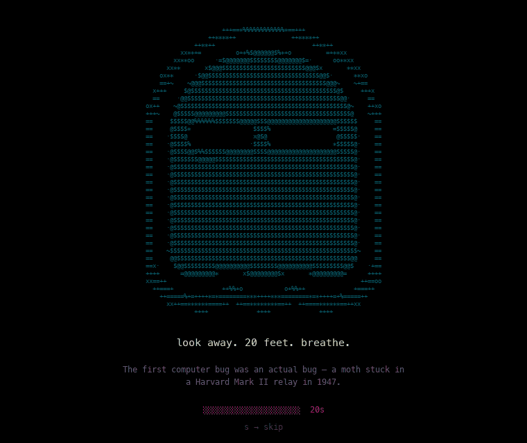

# rest-in-pixels 👻

A little ghost that reminds you to rest your eyes.

Every 20 minutes, your screen goes dark and an animated ASCII ghost floats in with a random fun fact. Look away, breathe, and come back refreshed. macOS only.



## What it does

- **Every 20 minutes** a full-screen overlay appears on all your displays
- **20-second break**, then press any key or click to dismiss
- **Press `s`** to skip the break early, or **`Esc`** to quit instantly
- **Starts automatically** when you log in

Based on the 20-20-20 rule: every 20 minutes, look at something 20 feet away for 20 seconds.

## Install

You need macOS and the Xcode Command Line Tools (`xcode-select --install`).

```bash
git clone https://github.com/Athulya-cloud/rest-in-pixels.git ~/.eyecare
cd ~/.eyecare
swiftc -O -o rest-in-pixels overlay.swift -framework Cocoa
```

Turn on the reminder:

```bash
sed "s|__HOME__|$HOME|g" com.eyecare.reminder.plist > ~/Library/LaunchAgents/com.eyecare.reminder.plist
launchctl load ~/Library/LaunchAgents/com.eyecare.reminder.plist
```

The first break appears right away. Want to preview it without the scheduler? Run `~/.eyecare/rest-in-pixels`.

## Turn it off

Pause the reminders (they stay off until you turn them back on, and across restarts):

```bash
launchctl unload -w ~/Library/LaunchAgents/com.eyecare.reminder.plist
```

Turn them back on:

```bash
launchctl load -w ~/Library/LaunchAgents/com.eyecare.reminder.plist
```

Stuck on the overlay? Press `Esc`.

## Uninstall

```bash
launchctl unload ~/Library/LaunchAgents/com.eyecare.reminder.plist
rm ~/Library/LaunchAgents/com.eyecare.reminder.plist
rm -rf ~/.eyecare
```

## Customize

| To change | Edit |
|---|---|
| Time between breaks | `StartInterval` in `com.eyecare.reminder.plist` (seconds, default `1200`) |
| Break length | `countdown` in `overlay.swift` (default `20`) |
| Fun facts | `facts.json` |
| Colors and fonts | the top of `overlay.swift` |

After editing `overlay.swift`, rebuild with the `swiftc` command above. After editing the plist, copy it to `~/Library/LaunchAgents/` again (same `sed` command) and turn it off and on.

## Troubleshooting

Errors are logged to `~/.eyecare/error.log`.

## Built with

Swift (AppKit) and a launchd LaunchAgent. No dependencies, no Xcode project.
